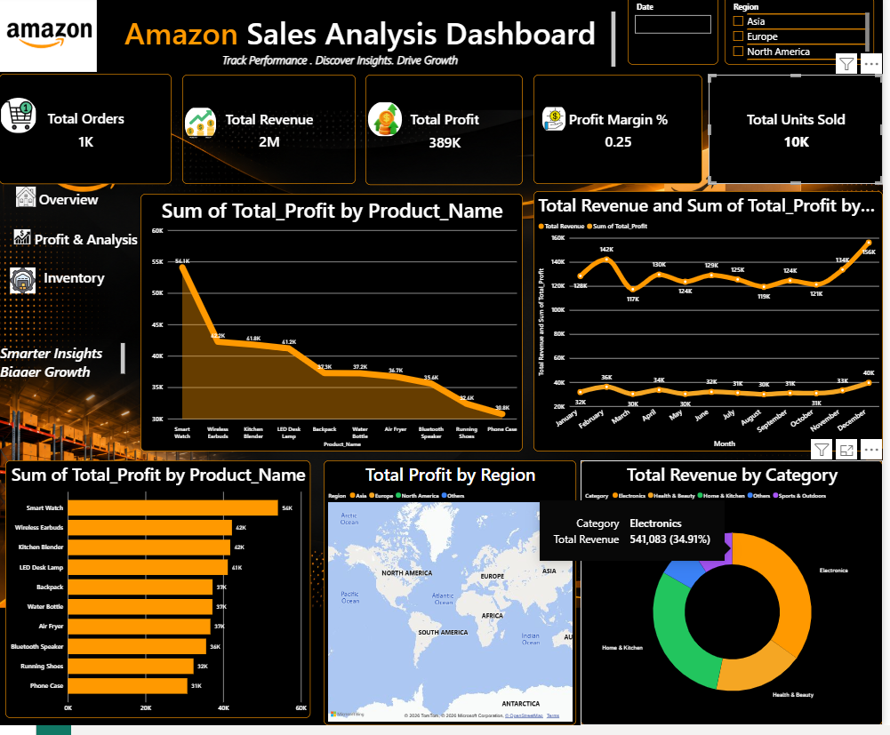

# 🛒 Amazon Sales Analysis Dashboard

> Track Performance • Discover Insights • Drive Growth[cite: 10]

A comprehensive Power BI dashboard designed to analyze and visualize Amazon sales data, tracking key revenue metrics, product performance, regional distribution, and inventory status with a modern dark-themed UI.

---

## 📸 Dashboard Preview



---

## 🚀 Key Features & Visuals

* **Executive KPI Cards:** Real-time tracking of Total Revenue ($742.1K), Total Orders (8,953), Total Units Sold (12.6K), Total Profit ($187.4K), and Profit Margin (25.3%) with MoM growth indicators[cite: 10].
* **Monthly Sales Trend:** Dual-line chart comparing monthly Revenue and Profit trajectories over the year[cite: 10].
* **Sales by Category:** Donut chart breaking down sales distribution across Electronics, Home & Kitchen, Health & Beauty, Sports & Outdoors, and Others[cite: 10].
* **Top 10 Best Selling Products:** Bar chart highlighting top-performing products ranked by sales revenue[cite: 10].
* **Sales by Region:** Map visual mapping global distribution and regional revenue shares (North America, Europe, Asia, and Others)[cite: 10].
* **Inventory Status:** Stock monitoring visual displaying stock level breakdown (In Stock, Low Stock, Out of Stock) with automated alerts[cite: 10].

---

## 🛠️ Tech Stack & Tools

* **Data Analysis & Transformation:** Power Query, DAX (Time Intelligence measures like `SAMEPERIODLASTYEAR`, `DIVIDE`)
* **Data Visualization:** Power BI (Dark Theme custom UI with `#0D0D0D` background and `#FF7A00` accents)
* **Version Control:** Git & GitHub

---

## 📊 DAX Measures Used

Sample key measure implemented for Year-over-Year Revenue Growth:

```dax
Revenue Growth % = 
VAR CurrentRevenue = [Total Revenue]
VAR PreviousRevenue = 
    CALCULATE(
        [Total Revenue],
        SAMEPERIODLASTYEAR(amazon_sales_data[Date])
    )
RETURN
    DIVIDE(
        CurrentRevenue - PreviousRevenue,
        PreviousRevenue,
        0
    )
